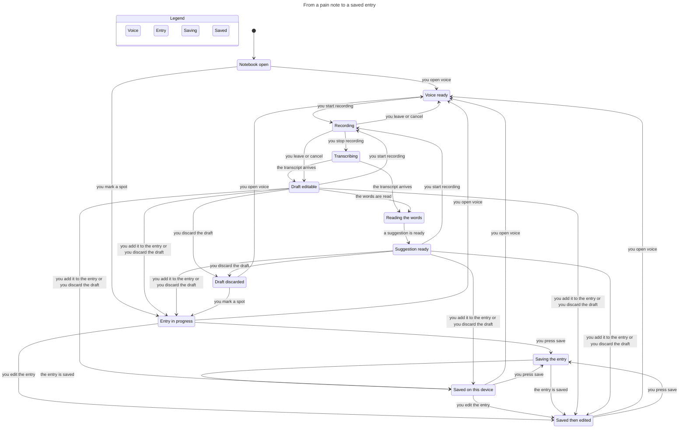

# Capture and save

This picture is the path from an empty notebook to a saved entry, including voice. It draws 12 states and 32 arrows. TLC checked 178 states in this slice. The full check is larger and is what `run.sh` runs.

Add and discard can land on the same screen when an entry was already open. Discard throws away the voice text and leaves that entry.

The picture hides these steps. The full model still checks them.

- Waiting, and a second tap while a save is running
- Reopening the app
- Storing the draft, closing voice, and editing the transcript, which stay on the same screen or return to the entry already open
- A late transcript, a late suggestion, a failed draft write, and a failed save
- Delete, undo, and another tab saving a different entry
- Research landing during a save, research merged from a draft, and research after delete
- A search with no version, typing a newer note, a stale save of an older note, and a research write that keeps the note
- A note edit or a title, pin, or context edit while a save is in flight, the merge that keeps a newer stored note, and the editor catching up after the save. The chart config leaves those races off

Read results with the pstack /statechart skill.

